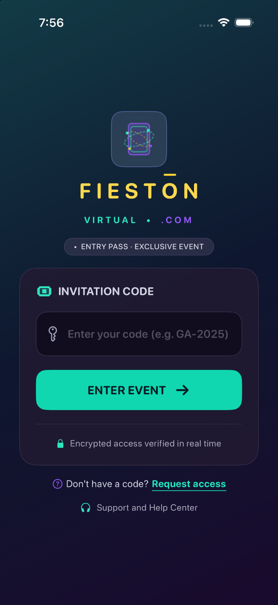
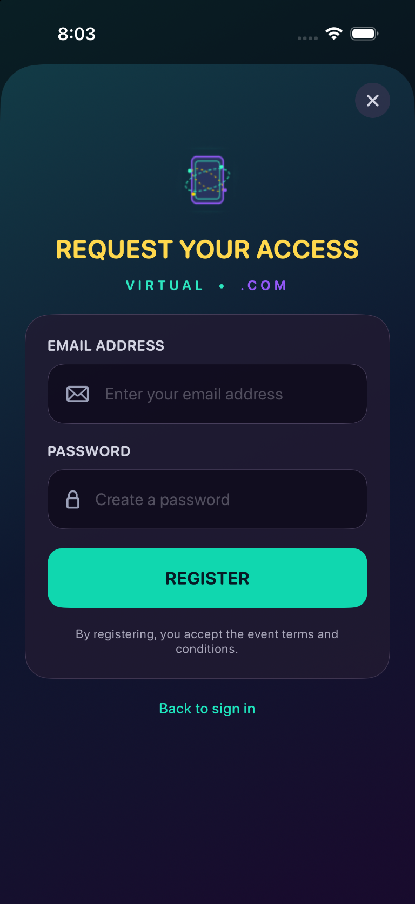
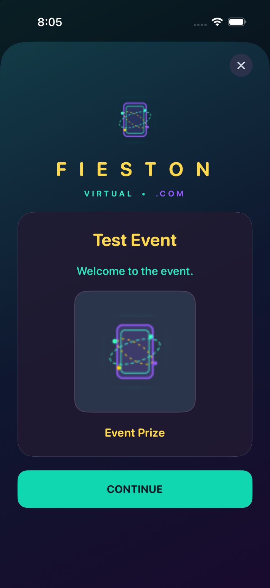
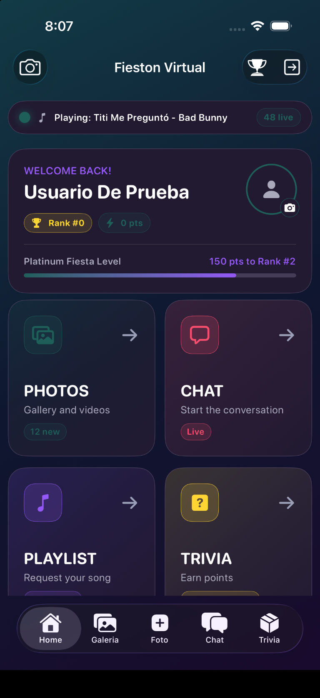
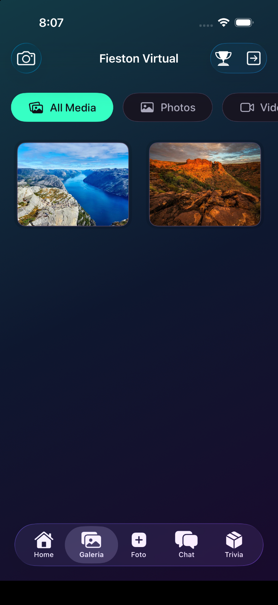

# 🎉 Fiestón Virtual

Fiestón Virtual es una aplicación iOS desarrollada en SwiftUI para acompañar
eventos virtuales. Permite a los asistentes identificarse con un código de
evento, participar en actividades interactivas y compartir la experiencia con
el resto de la comunidad.

---

# 📱 Funcionalidades

- Acceso y verificación mediante código de evento
- Registro y gestión del perfil de usuario
- Inicio personalizado con las actividades del evento
- Chat en tiempo real mediante Socket.IO
- Galería colaborativa de fotos y vídeos
- Publicación de fotografías desde la cámara o la galería
- Reacciones y comentarios en el contenido compartido
- Playlist musical con reproducción de canciones
- Trivia interactiva
- Ranking de participantes
- Notificaciones push mediante Firebase Cloud Messaging
- Persistencia local con Core Data

---

# 📸 Experiencia visual

### Identidad y acceso

<div style="display: flex; gap: 10px;">
    
    
</div>

### Welcome



### Home



### Galería



---

# 🏗 Arquitectura

El proyecto utiliza una arquitectura MVVM organizada en capas:

- **Presentation:** vistas SwiftUI, view models, navegación y componentes
  reutilizables.
- **Domain:** modelos de negocio, repositorios y casos de uso.
- **Data:** entidades, fuentes de datos y repositorios concretos.
- **DataBase:** modelo de Core Data para la persistencia local.
- **DI:** inyección de dependencias mediante Swinject.

La comunicación con el backend se realiza mediante Alamofire y Combine. El
chat utiliza Socket.IO para recibir y enviar mensajes en tiempo real.

---

# 📂 Estructura del proyecto

```text
FiestonVirtual
├── Sources
│   ├── Data
│   ├── DataBase
│   ├── Domain
│   ├── Main
│   └── Presentation
│       ├── DI
│       ├── Framework
│       └── UI
│           ├── EventCode
│           ├── Main
│           ├── PlayList
│           ├── Ranking
│           ├── Register
│           └── Welcome
└── Resources
    ├── Assets.xcassets
    └── GoogleService-Info.plist
```

---

# 🛠 Stack tecnológico

- Swift 5.9
- SwiftUI
- iOS 15+
- MVVM
- Combine
- Tuist
- Core Data
- Firebase Core y Firebase Messaging
- Alamofire
- Socket.IO
- Swinject
- Kingfisher
- SwiftUIPager
- SwiftyJSON

---

# ⚙️ Instalación

## Requisitos

- macOS con Xcode
- Tuist `4.202.6`
- Una configuración válida del backend
- `GoogleService-Info.plist` para Firebase

## Preparar el proyecto

1. Clona el repositorio:

   ```bash
   git clone https://github.com/CarlitosDroid/freelo-ios-fieston-virtual.git
   cd freelo-ios-fieston-virtual
   ```

2. Instala las dependencias y genera el proyecto:

   ```bash
   tuist install
   tuist generate
   ```

3. Configura el host de la API en
   `FiestonVirtual/Configs/Secrets.xcconfig`. Para un dispositivo físico,
   utiliza la dirección IP o el nombre local del Mac que ejecuta el backend.

4. Abre `FiestonVirtual.xcworkspace` en Xcode, selecciona el esquema
   `FiestonVirtual` y ejecuta la aplicación.

---

# 🧪 Tests

Para ejecutar los tests desde Fastlane:

```bash
bundle install
bundle exec fastlane ios test
```

También puedes ejecutar `FiestonVirtualTests` y `FiestonVirtualUITests`
directamente desde Xcode.

---

# 👨‍💻 Autor

Ronaldo Vargas  
Ingeniería de Sistemas  
iOS Developer
